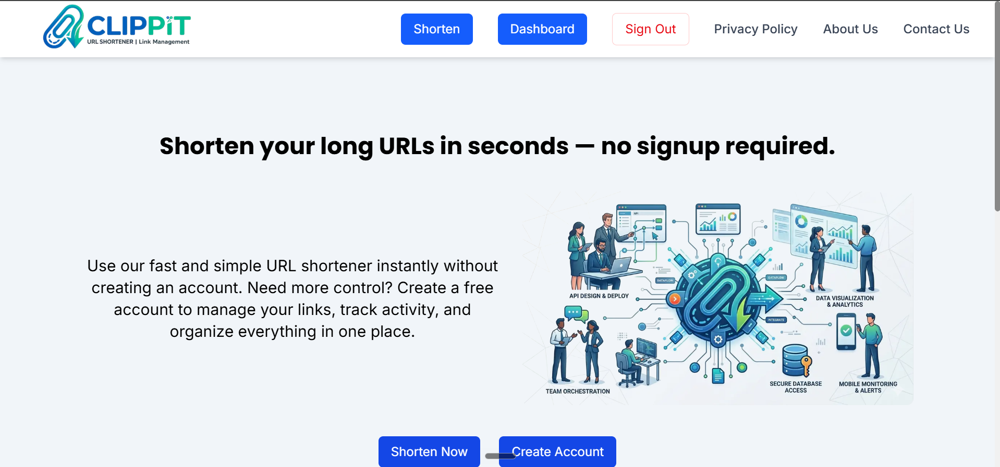

# Clippit

A modern URL shortener built with Next.js. Sign in, shorten long links, set custom slugs and expiry dates, and track clicks from a clean dashboard.



**Live Demo:** [clippit-link.vercel.app](https://clippit-link.vercel.app)

## Features

- Google and GitHub sign-in with NextAuth.js
- Short links with your own custom slug
- Optional expiry date for each link
- Click tracking on every short link
- Dashboard with stats cards and a links table (copy, open, delete)
- Fully responsive UI with smooth Framer Motion animations

## Tech Stack

- **Framework:** Next.js (App Router, JavaScript)
- **Database:** MongoDB with Mongoose
- **Authentication:** NextAuth.js v4 (Google and GitHub OAuth)
- **Styling:** Tailwind CSS
- **Animations:** Framer Motion

## Getting Started

```bash
git clone https://github.com/saudus192/clippit.git
cd clippit
npm install
```

Create a `.env.local` file in the project root:

```env
MONGODB_URI=your_mongodb_connection_string
NEXT_PUBLIC_URL=http://localhost:3000/ <!-- With ending slash -->
NEXTAUTH_URL=http://localhost:3000 <!-- Without ending slash -->
NEXTAUTH_SECRET=your_random_secret
GOOGLE_CLIENT_ID=your_google_client_id
GOOGLE_CLIENT_SECRET=your_google_client_secret
GITHUB_ID=your_github_client_id
GITHUB_SECRET=your_github_client_secret
```

Then start the dev server:

```bash
npm run dev
```

Open [http://localhost:3000](http://localhost:3000) in your browser.

## License

Released under the [MIT License](./LICENSE).

## Author

**Saud Usman**, web developer (MERN Stack, Next.js).
GitHub: [@saudus192](https://github.com/saudus192)
